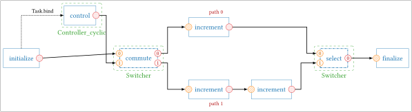
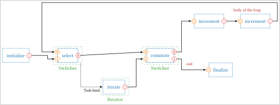

# Branches and loops

A sequence executes its tasks in a fixed order. To take one path or another, or to
repeat a part of the graph, StreamPU provides **control flow modules**:

| Module | Role |
|--------|------|
| `spu.Switcher` | its task `commute` sends the data to one of several paths, its task `select` takes the data of the path that was executed |
| `spu.Controller_static`, `spu.Controller_cyclic`, `spu.Controller_limit` | output the index of the path to take |
| `spu.Iterator` | outputs `0` for a given number of executions, then `1`: it controls a loop |
| `spu.Set` | wraps a whole sequence into a single task |

The examples of this page use small `initializer` / `incrementer` / `finalizer` chains,
described in a [`with spu.sequence()` block](../tutorial/sequence.md#describe-the-sequence-in-a-with-block).

## Exclusive paths

A `Switcher` has two tasks:

- `commute(in_data, in_ctrl)` copies `in_data` to **one** of its outputs `out_data0`,
  `out_data1`…, the one whose index is given by `in_ctrl`;
- `select(in_data0, in_data1, ...)` outputs the data of the path that was executed.

Only the tasks of the chosen path are executed: the sequence skips the others.

<figure markdown="span">
  
  <figcaption>Two exclusive paths: path 0 adds 1, path 1 adds 2. The controller alternates between them.</figcaption>
</figure>

```python
import streampu as spu

N = 4
ini = spu.initializer(N, dtype=spu.int32)
ctl = spu.Controller_cyclic(2)          # 0, 1, 0, 1...
sw = spu.Switcher(2, N, spu.int32)      # 2 paths, data of N int32
incs = [spu.incrementer(N, dtype=spu.int32) for _ in range(3)]
fin = spu.finalizer(N, dtype=spu.int32)

with spu.sequence() as seq:
    data = ini.initialize()
    ctl.control.bind(data)              # execute the controller after the initializer
    path0, path1 = sw.commute(data, ctl.control())
    a = incs[0].increment(path0)                    # path 0: + 1
    b = incs[2].increment(incs[1].increment(path1)) # path 1: + 2
    fin.finalize(sw.select(a, b))

ini.data_init[0][:] = 1
for _ in range(4):
    seq.exec_seq()
    print(fin.final_data[0])
```

```text
[2, 2, 2, 2]
[3, 3, 3, 3]
[2, 2, 2, 2]
[3, 3, 3, 3]
```

`ctl.control.bind(data)` makes the controller depend on the initializer (see
[`Task.bind`](../tutorial/parallelism.md#dependencies-without-data)). Without it, the
controller would have no input and would be a first task of the sequence, executed
before the data exist.

The controllers differ by the path they output at each execution:

| Controller | Paths |
|------------|-------|
| `spu.Controller_static(path)` | always `path` (it can be changed between two executions with `ctl.path = ...`) |
| `spu.Controller_cyclic(n_paths, init_path=0)` | `init_path`, `init_path + 1`, … modulo `n_paths` |
| `spu.Controller_limit(limit, init_path=0)` | `init_path` for the first `limit` executions, then the other path |

The control socket `in_ctrl` is an `spu.int8` socket of one element: the output of a
controller, of an `Iterator`, or of any task of the graph with the same type.

The paths of a `Switcher` all have the same size and data type. A `Switcher` whose
commuted and selected data differ is built with
`spu.Switcher(n_paths, n_elmts_commute, dtype_commute, n_elmts_select, dtype_select)`.

!!! warning
    Do not create constants inside a path: `path1 * 10` creates a constant (an
    `Array.read` task, see [Working with sockets](socket_operations.md)) at the place of
    the call, and the path is then not executed correctly. Create the constants before
    `commute` (`ten = spu.array([10] * N, dtype=spu.int32)`, then `path1 * ten`).

## Loops

A loop is a `Switcher` whose `select` takes either the data entering the loop or the
data coming back from the body of the loop, and whose `commute` sends the data either
to the body of the loop or out of it. An `Iterator` drives `commute`: it outputs `0`
(stay in the loop) `limit` times, then `1` (leave the loop), and starts again.

<figure markdown="span">
  
  <figcaption>A loop that executes its body 3 times. The output of the body goes back to the input 0 of <code>select</code>.</figcaption>
</figure>

```python
N = 4
ini = spu.initializer(N, dtype=spu.int32)
sw = spu.Switcher(2, N, spu.int32)
it = spu.Iterator(3)                     # 3 iterations
inc = spu.incrementer(N, dtype=spu.int32)
fin = spu.finalizer(N, dtype=spu.int32)

with spu.sequence() as loop:
    x = ini.initialize()
    it.iterate.bind(sw.select)           # count after each select
    body, done = sw.commute(sw["select::out_data"], it.iterate())
    y = inc.increment(body)              # body of the loop
    sw.select(y, x)                      # input 0: back from the body, input 1: entering the loop
    fin.finalize(done)

ini.data_init[0][:] = 0
loop.exec_seq()
print(fin.final_data[0])                 # [3, 3, 3, 3]
```

Two points are specific to loops:

- `sw.select(y, x)` is called **after** the body, because `y` is computed by the body.
  Its output is used before, by `sw.commute(sw["select::out_data"], ...)`: the socket is
  reached by its name, since `select` has not been called yet;
- `select` is executed at each turn of the loop, and `it.iterate.bind(sw.select)` makes the
  iterator count after it.

A *do-while* loop, whose body is executed before the test, puts the body between
`select` and `commute`: see `tests/bootstrap/test_do_while_loop.py`.

## A sequence as a single task

`spu.Set` wraps a sequence into a module with one task, `exec`. The sub-sequence can then
be reused as a block in another sequence. Its first task gives the input socket `in` of
`exec`, its last task the output socket `out`:

```python
incs = [spu.incrementer(N, dtype=spu.int32) for _ in range(3)]
with spu.sequence() as sub:              # the sub-sequence: three incrementers
    y = incs[0].increment()
    for inc in incs[1:]:
        y = inc.increment(y)
three = spu.Set(sub.sequence)

ini = spu.initializer(N, dtype=spu.int32)
fin = spu.finalizer(N, dtype=spu.int32)
with spu.sequence() as main:
    fin.finalize(three.exec(ini.initialize()))

ini.data_init[0][:] = 5
main.exec_seq()
print(fin.final_data[0])                 # [8, 8, 8, 8]
```

A `Set` is cloned like any other module when the sequence runs on several threads.

## Iterating in Python with `Range`

`spu.Range(stop, start=0, step=1, dtype=spu.int32)` outputs `start`, `start + step`… up to
`stop` (excluded), one value per execution of its task `iterate`. It is also a Python
iterator, which executes the task at each step:

```python
>>> [int(s.numpy[0][0]) for s in spu.Range(5, start=1, step=2)]
[1, 3]
```

When the range is exhausted, the next execution raises `StopIteration` (which ends a
Python `for` loop). With `rng.throw_to_stop = False`, it outputs the last value again with
its output `flg` set to `1`, then starts over from `start`.
