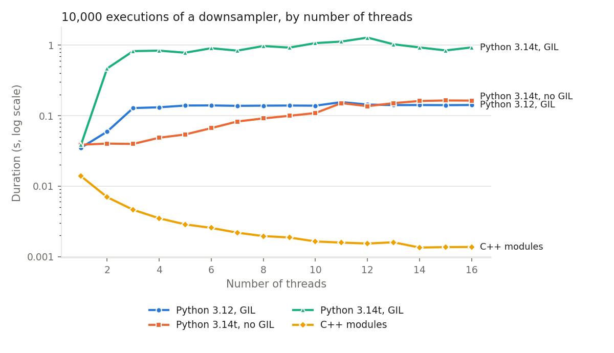

# Writing a module in Python

When the processing you need is not available as a built-in module, you can write it
in Python. A `spu.Stateless` module holds tasks whose **codelet**, the function
executed by the task, is a Python function. Such a module is used exactly like the
built-in ones: its tasks can be called, bound, put in a sequence or a pipeline, and
duplicated on several threads.

## Create the module, its task and its sockets

As an example, we write a module with a task `scale` that multiplies 8 floats by 2.

```python
import streampu as spu

N = 8

mdl = spu.Stateless()
task = mdl.create_task("scale")
mdl.create_socket_in(task, "x", N, spu.float32)
mdl.create_socket_out(task, "y", N, spu.float32)
```

- `create_task(name)` adds a task to the module and returns it;
- `create_socket_in`, `create_socket_out` and `create_socket_fwd` add an input,
  output or forward socket to a task, given its name, its number of elements and its
  data type.

## Write the codelet

The codelet receives the module, the task and a frame index, and returns a status
(`0` means success). Inside the codelet, the data of the sockets is accessed **without
copy** through their `numpy` attribute:

```python
def scale(module, task, frame_id):
    x = task.x.numpy   # or task["x"].numpy
    y = task.y.numpy
    y[:] = 2 * x       # write the output in place
    return 0

mdl.create_codelet(task, scale)
```

!!! warning
    The output must be written **in place** (`y[:] = ...`). Writing `y = 2 * x` would
    only rebind the local variable `y` and leave the socket unchanged.

The arrays are 2D (one row per frame): write the codelet so that it works on all the
rows, as above.

## Use the module

The task can now be called like any other task:

```python
>>> x = spu.arange(0, 8, dtype=spu.float32)
>>> y = mdl.scale(x)
>>> y.numpy
array([[ 0.,  2.,  4.,  6.,  8., 10., 12., 14.]], dtype=float32)
```

It can be combined with operators and other modules, and replayed by a sequence:

```python
>>> z = mdl.scale(x) + 1
>>> seq = spu.Sequence(z)
>>> seq.exec_n_times(10)
```

Use `spu.help(mdl)` to display its tasks and sockets.

## Several threads

A `Stateless` module is **cloned automatically** when it is part of a
[multithreaded sequence](../tutorial/parallelism.md). All the clones share the same
codelet function, so the codelet must not keep any state between two calls (in global
variables or in a closure): everything it needs must come from its input sockets.

With a regular Python interpreter, the codelets of the different threads cannot run
Python code at the same time because of the GIL. Two solutions:

- **compile the heavy part of the codelet with [numba](https://numba.pydata.org/)** and
  the `nogil=True` option, so that the compiled code runs without holding the GIL:

    ```python
    import numba

    @numba.njit(nogil=True, cache=True)
    def _scale(x, y):
        for f in range(x.shape[0]):
            for i in range(x.shape[1]):
                y[f, i] = 2 * x[f, i]

    def scale(module, task, frame_id):
        _scale(task.x.numpy, task.y.numpy)
        return 0
    ```

- **use a free-threaded Python** (3.14t) and run it with `PYTHON_GIL=0`: the codelets
  of all the threads then run in parallel.

The scripts of `examples/custom_python_module` compare the execution times of a
Python module with different Python interpreters and numbers of threads.

## Modules with a state

A `Stateless` module cannot hold parameters or data of its own. When the processing
depends on parameters or must keep data between two executions, derive a class from
`spu.Stateful_core`. The example below keeps one sample out of `F`; `F` is the state of the
module:

```python
--8<-- "examples/custom_python_module/downsampler.py"
```

It is used like any other module:

```python
>>> from downsampler import Downsampler
>>> dwn = Downsampler(N=8, F=2, dtype=spu.int32)
>>> y = dwn.downsample(spu.array(list(range(8)), dtype=spu.int32))
>>> y.numpy
array([[0, 2, 4, 6]], dtype=int32)
```

Three rules make such a module work on several threads:

1. **Store the state as attributes of the module** (`self.F`).
2. **Read the state from the `mdl` argument of the codelet**, never from a `self`
   captured when the codelet is created: the same codelet is executed by every clone of
   the module, and `mdl` is the clone that executes it.
3. **Implement `clone()`**. StreamPU calls it to duplicate the module, then copies the
   tasks, sockets and codelets itself. `clone()` must therefore create an instance of
   the same class, `type(self)`, without calling `__init__` (which would create the
   tasks a second time), and only copy the Python state.

The script `examples/custom_python_module/custom_python_module.py` uses this module in
a multithreaded sequence and measures its duration for different numbers of threads.

## Performance with several threads

The script `examples/custom_python_module/custom_python_module.py` runs 10,000
executions of a sequence containing the `Downsampler` above, for 1 to 16 threads, with
different Python interpreters. As a reference, it also runs the same processing with
C++ modules (a `relayer` followed by a slice `x[::4]`).

<figure markdown="span">
  
  <figcaption>Duration of 10,000 executions of a sequence with a Python module or with C++ modules, for 1 to 16 threads.</figcaption>
</figure>

| Configuration | 1 thread | 16 threads |
|---------------|----------|------------|
| Python 3.12, GIL | 35 ms | 142 ms |
| Python 3.14t, no GIL (`PYTHON_GIL=0`) | 39 ms | 164 ms |
| Python 3.14t, GIL (`PYTHON_GIL=1`) | 39 ms | 932 ms |
| C++ modules | 13.9 ms | 1.4 ms |

What it shows (note the logarithmic scale):

- **The C++ modules are faster and scale with the number of threads**: on 1 thread,
  they are 2.5 times faster than the Python module; on 16 threads, they run 10 times
  faster than on 1 thread, and about 100 times faster than the best Python configuration.
- **The Python module does not scale**: the work done by its codelet is tiny (a NumPy
  slice), so the cost of entering the Python interpreter at each call dominates, and
  adding threads only adds contention. With the GIL, the threads wait for each other
  and the duration increases with the number of threads; on Python 3.14t with the GIL
  enabled, this is particularly costly.
- **Without the GIL** (Python 3.14t, `PYTHON_GIL=0`), the duration stays flat up to 3
  threads and grows slowly afterwards, but never decreases.

To benefit from several threads with a Python module, give each call more work (larger
frames, several frames per execution with `n_frames`), release the GIL in the heavy
part of the codelet (numba with `nogil=True`), or write the module in C++.

Run `examples/custom_python_module/perform_comparison.sh` to reproduce these measures
on your machine.

## When to write a C++ module instead

A Python codelet is convenient but each call has a cost. For processing that is
executed very often on small data, write the module in C++: see
[Writing a module in C++](cpp_module.md).
