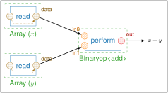

# pyStreamPU

**pyStreamPU** is the Python interface of [StreamPU](https://github.com/aff3ct/streampu),
a C++ Domain Specific Embedded Language (DSEL) for building high-throughput,
low-latency streaming applications on multicore CPUs.

With the `streampu` package you build, from Python, a data-flow graph of **tasks**
exchanging data through **sockets**, and let the StreamPU runtime execute it,
sequentially or in parallel. The bindings are generated with
[pybind11](https://pybind11.readthedocs.io/en/stable/).

```python
import streampu as spu

x = spu.array([1, 2, 3], dtype=spu.uint8)
y = spu.array([4, 5, 6], dtype=spu.uint8)
print(x + y)  # [[5 7 9]]
```

<figure markdown="span">
  
  <figcaption>The graph built by <code>x + y</code>: the <code>data</code> sockets of two <code>Array</code> modules are bound to the inputs of a <code>Binaryop&lt;add&gt;</code> module.</figcaption>
</figure>

## Where to start?

<div class="grid cards" markdown>

-   **[Installation](install.md)**

    Build and install `streampu` from the sources.

-   **[Tutorial](tutorial/first_steps.md)**

    Learn sockets, tasks, modules and sequences step by step.

-   **[How-to guides](guides/socket_operations.md)**

    Recipes for specific tasks: operators, custom modules, branches and loops, profiling, debugging…

-   **[Concepts](concepts.md)**

    Understand the model behind StreamPU.

-   **[API reference](reference/index.md)**

    Technical description of classes and functions.

</div>

## Citing

If you use StreamPU in your work, please cite:

> A. Cassagne, R. Tajan, O. Aumage, D. Barthou, C. Leroux and C. Jégo,
> *StreamPU: A DSEL for High Throughput and Low Latency Software-Defined Radio on
> Multicore CPUs*, Wiley Concurrency and Computation: Practice and Experience,
> vol. 35, no. 23, e7820, 2023. [doi:10.1002/cpe.7820](https://doi.org/10.1002/cpe.7820)

The BibTeX entry is available in `CITATION.bib` at the root of the repository.
