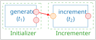

# First steps with StreamPU in Python

This section presents the first steps for playing with [StreamPU](https://aff3ct.github.io/streampu) in Python.
It covers the following key concepts of StreamPU:

- [socket](https://aff3ct.github.io/streampu/socket/): the data holder
- [task](https://aff3ct.github.io/streampu/task/): the data processing
- [module](https://aff3ct.github.io/streampu/module/): the tasks holder
- [sequence](https://aff3ct.github.io/streampu/sequence/): a directed and acyclic graph of tasks

## How to import StreamPU?

As every Python package `StreamPU` may be imported using the `import` interface.

```python
>>> import streampu as spu
```

## Organisation of this documentation
Code blocks starting with `>>>` are typed in a Python interpreter; the lines without prompt are the output. The following code block is the start of an example running through this page.
```python
>>> x = spu.array([1,2,3,4])

>>> x
socket([[1 2 3 4]], dtype=int64, name=data, task=Array.read)
```

As the output suggests, `x` is a `Socket`.

## What is a Socket ?
A `socket` is a way to exchange data between `tasks` (that process this data). The output of the previous example
```
socket([[1 2 3 4]], dtype=int64, name=data, task=Array.read)
```
indicates that sockets have the following attributes:

- `name`: the name of the socket in the task
- `dtype` : data type
- `task` : the task that holds this socket


### The name of a socket
You may get the name of a socket as follows
```python
>>> x.name
'data'
```

!!! warning
    The `name` attribute of a socket is read-only, **you cannot change it**.

The name of a socket will be important when you will want to bind the output of a task to the input of another task.

### Get the task that owns a socket

To recover the task that holds a socket just do
```python
>>> x.task
<streampu._ext.core.Task object at 0x10618c3f0>
```

!!! warning
    1. The `task` attribute of a socket is read-only, **you cannot change it**.
    2. `streampu._ext` indicates that the `Task` class belongs to the C++ part of `streampu` package.

### Get the socket data type (dtype)
The data stored in a socket is strongly typed:
```python
>>> x.dtype
spu.int64
```
This output indicates that the elements of `x` are integers stored on `64` bits.

!!! note "StreamPU data types"
    `spu` recognizes the following data types:

    - **Unsigned integers**: `spu.uint8`, `spu.uint16`, `spu.uint32`, `spu.uint64`
    - **Signed integers**: `spu.int8`, `spu.int16`, `spu.int32`, `spu.int64`
    - **Floating point**: `spu.float32`, `spu.float64`


### Accessing the socket direction
In addition to its `name`, `task` and `dtype` attributes, another important concept is the socket **direction**.
There are 3 different types of socket directions:

- **Input socket**: read only data,
- **Output socket**: write only data,
- **Forward socket**: read and write data.

The socket direction can be recovered as follows
```python
>>> x.direction
<directions.FWD: 2>
```
Here `x` is a forward socket.

!!! note "Socket directions"
    Socket directions are stored in the enum `spu.Socket.directions`:

    -  `spu.Socket.directions.IN`: input socket
    -  `spu.Socket.directions.OUT`: output socket
    -  `spu.Socket.directions.FWD`: forward socket


### Creating a socket from data
As we have seen in the example, the function `spu.array` converts the list [1,2,3,4] into a `socket`.

The same goes for a 1D NumPy array.

```python
>>> import numpy as np
>>> x = np.array([1,2,3,4], dtype = np.int8)
>>> x
array([1, 2, 3, 4], dtype=int8)
>>> y = spu.array(x)
>>> y
socket([[1 2 3 4]], dtype=int8, name=data, task=Array.read)
```
From this example, you can see that the NumPy dtype `int8` is propagated to the socket created by `spu.array`.

!!! warning
    There is no copy when creating a socket from a NumPy array!
    Hence, if we modify the numpy data, the socket data is modified accordingly, for example
    ```python
    >>> x[2] = 42
    >>> y
    socket([[ 1  2 42  4]], dtype=int8, name=data, task=Array.read)
    ```

### Converting a socket into a numpy array
You can create a NumPy array from a socket by using its `numpy` attribute as follows
```python
>>> x = spu.array([1,2,3,4])
>>> y = x.numpy
>>> y
array([[1, 2, 3, 4]], dtype=int64)
```
!!! note
    1. The NumPy array will have the numpy dtype corresponding to the one of the socket.
    2. This conversion is also copy-free, hence in the previous example, changing `y` will affect the data of `x`.


## What is a module?
A `module` is an object that can store one or several tasks.

For example, suppose that we want to randomly generate `8` bits from a Bernoulli distribution. We can build this module from the factory method `spu.source_random` as follows

```python
>>> src = spu.source_random(8, dtype = spu.int64)
>>> src
<streampu._ext.src.Source_random_int64 object at 0x106f82150>
```

!!! note
    In this example, the type of `src` is `Source_random_int64`. Within the package, this class is located in: `streampu._ext.src`.

    `Source_random_int64` indicates that the output dtype of the data generated by `src` will have `int64` dtype.

### How to know the tasks of a given module?
There are several ways of accessing the tasks of a module.
The simpler one is by accessing its `tasks` attribute to get the list of all the module's tasks as shown in the following example.
```python
>>> src.tasks
[<streampu._ext.core.Task object at 0x1065c0970>]
```

If you just want to get information about the tasks of one module, `spu` comes with `spu.help`

```python
>>> spu.help(src)
# module:
# |- name: Source_random
# |- short name: Source
# |- n_frames: 1
# |- tasks:
# |  |- name: generate
# |  |  |- sockets out:
# |  |  |  |- out_data: { n_elts = 8, datatype = int64 }
# |  |  |  |- out_count: { n_elts = 1, datatype = uint32 }
# |  |  |  |- status: { n_elts = 1, datatype = int32 }
```

Here we see that `src` has one task named `generate` that has 3 outputs:

- `out_data`: 8 elements of type `int64`
- `out_count`: 1 element of type `uint32`
- `status`: 1 element of type `int32`

## What is a task?
According to the StreamPU documentation, "a task represents the code executed by a node in the data flow graph".

### Accessing the task of a module
#### Using the `tasks` attribute
There are several ways of getting the task of a given module.

The first one is by using the `tasks` attribute as follows
```python
>>> src.tasks[0]
<streampu._ext.core.Task object at 0x1065c0970>
```
#### Using `mdl[tsk_name]`
If you know the name of the task, you can also write
```python
>>> src['generate']
<streampu._ext.core.Task object at 0x1065c0970>
```

#### Using `mdl.tsk_name`
A task can also be accessed as if it is a module attribute as follows
```python
>>> src.generate
<streampu._ext.core.Task object at 0x1065c0970>
```

!!! note
    All methods to access a task will get the same object. The three methods are kept so that a C++ user of StreamPU can easily translate a C++ program to a python program.

### How to know the sockets of a task
To know the sockets of a task, we can simply use `spu.help`, but on a task.
```python
>>> spu.help(src.generate)
|- name: generate
|  |- sockets out:
|  |  |- out_data: { n_elts = 8, datatype = int64 }
|  |  |- out_count: { n_elts = 1, datatype = uint32 }
|  |  |- status: { n_elts = 1, datatype = int32 }
```

### How to access a socket of a task?
#### Using the `sockets` attribute of a task
Every task has a `sockets` attribute that contains the lists of its sockets.

!!! warning
    The sockets in `tsk.sockets` appear in the order of their creation. There is no convention for having for example the input sockets first.

    Use `tsk.inputs`, `tsk.outputs`, and `tsk.forwards` to get the inputs, output or forward sockets respectively.

#### By getting the `socket_name` item of a socket
We can access a socket of a task as follows
```python
>>> tsk = src['generate']
>>> tsk['out_data']
socket([[0 0 0 0 0 0 0 0]], dtype=int64, name=out_data, task=Source_random.generate)
```
#### By getting the `task_name::socket_name` item of a module
Another way of accessing the same socket is by accessing the item `'task_name::socket_name'` of a module as in the following example.
```python
>>> src['generate::out_data']
socket([[0 0 0 0 0 0 0 0]], dtype=int64, name=out_data, task=Source_random.generate)
```
#### By getting the `socket_name` attribute of a task
The last way for accessing the same socket is by using the socket name as a task attribute as follows.
```python
>>> src.generate.out_data
socket([[0 0 0 0 0 0 0 0]], dtype=int64, name=out_data, task=Source_random.generate)
```

!!! note
    Whatever the way you used to access the socket `out_data` in the previous examples, the content of the socket is filled with `0`. This is due to the fact that the task has never been executed.

### Execute a Task
The sockets of a task are filled when the task is executed. Let us execute the task `generate` of `src`.
```python
>>> src['generate'].exec()
>>> src.generate.out_data
socket([[0 1 1 0 1 1 1 1]], dtype=int64, name=out_data, task=Source_random.generate)
```
The generated bits are now written inside the socket data.

## How to build a processing sequence?

Suppose that we now want to increment the bits of `out_data`. To do so, we start by building an `incrementer` (which is also a `module`).

```python
>>> inc = spu.incrementer(8, dtype=spu.int64)
```
We can remark that `inc` has a task called `increment` that has one input socket called `in` and one output socket called `out`.

!!! warning
    As `in` is a keyword of the python language, we cannot use the syntax `inc.increment.in` to access it.
    ```python
    >>> inc.increment.in
    File "<stdin>", line 1
        inc.increment.in
                    ^^
    SyntaxError: invalid syntax
    ```
    Use the item syntax instead: `inc['increment::in']` or `inc.increment['in']`.

## Socket binding

To link the source `src` and the incrementer `inc`, the output socket `out_data` of the task `generate` of the module `src` should be "bound" to the input socket `in` of the task `increment` of the module `inc`.

```python
inc['increment::in'] = src['generate::out_data']
```

This line is schematically equivalent to the following figure.

<figure markdown="span">
  { width="250" }
  <figcaption>Figure: Binding between <code>src.generate.out_data</code> and <code>inc.increment.in</code>.</figcaption>
</figure>

## Tasks execution

Now we can execute the tasks of each module.

```python
>>> src['generate'].exec()
>>> src['generate::out_data']
socket([[1 0 0 1 1 0 1 0]], dtype=int64, name=out_data, task=Source_random.generate)
>>> inc['increment'].exec()
>>> inc['increment::out']
socket([[2 1 1 2 2 1 2 1]], dtype=int64, name=out, task=Incrementer.increment)
```

The values are random: yours will differ, but each output of `increment` is the
corresponding output of `generate` plus one.

## Debug mode activation

You can see that the data is automatically transferred from the output of `generate` to the input of `increment`.
The data printing can also be handled automatically by setting the `debug` property of the tasks to `True`.

```python
>>> src['generate'].debug = True
>>> inc['increment'].debug = True
>>> src['generate'].exec()
# Source_random::generate(int64 out_data[8], uint32 out_count[1])
# {OUT} out_data  = [    0,     0,     0,     1,     0,     1,     1,     0]
# {OUT} out_count = [    8]
# Returned status: [0 'SUCCESS']
#
>>> inc['increment'].exec()
# Incrementer::increment(const int64 in[8], int64 out[8])
# {IN}  in  = [    0,     0,     0,     1,     0,     1,     1,     0]
# {OUT} out = [    1,     1,     1,     2,     1,     2,     2,     1]
# Returned status: [0 'SUCCESS']
#
>>>
```

## Next steps
The next pages show how to [simplify these steps](going_further.md) and how to
[replay the graph with a Sequence](sequence.md).
